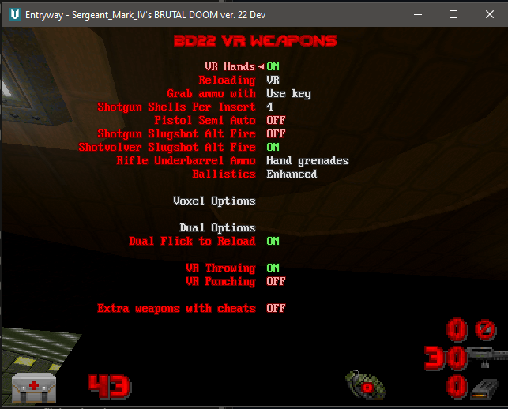

# BD22 VR Weapons

Coordinated, directed and tested by PresidentKoopa, coded by Claude.

VR weapon pack for **Brutal Doom v22** (`brutal22test6.pk3`) on **QuestZDoom 17.x**. Stock
engine, no engine changes. Fire each gun independently in dual-wield mode.

Download from the Releases page. Load it after `brutal22test6.pk3` and the Voxel pack.

## Models for
Pistol, Revolver, SMG, MP40\*\*, Rifle, Shotgun, Super shotgun, Assault shotgun, Minigun,
MG42 buzzsaw\*\*, Grenade launcher, Incendiary launcher, Rocket launcher, Nuke launcher,
Devastator\*\*, Hellish missile launcher\*\*, Plasma gun, Railgun, BFG, BFG10k, Unmaker,
Flamethrower, Flame cannon\*\*, Axe, Chainsaw, Fists, Grenades

\*\* = hidden from the player's roster. Turn on "Allow extra weapons with cheats" in the
options menu to get them through cheats (give all, idkfa).

## Features
- Posed VR hands on every weapon: hand on the grip, finger on the trigger, support hand.
- Manual, immersive reloading (when enabled):
  - magazines out and in;
  - slides, charging handles and pumps racked by hand;
  - the pistol slide and the rifle, SMG and assault shotgun bolts lock back when fired dry;
  - shotgun shells through the real loading port, topped off any time.
- Dual Wield support. Flick guns down arcade style to reload when akimbo.
- Grenade: pull the pin with the off hand. Hold the trigger, swing and release to throw; release
  while still to cook it. The axe throws the same way.
- A fist in each hand. The off-hand fist can be selected back after moving a gun there.
- VR punching (physical jabs and hooks), VR throwing and VR reloading can each be turned on/off.
- Left-handed support.
- A gun in each hand uses stock reload so the action isn't interrupted.
- VR reloading works on the main-hand weapon when the off hand is the fist.
- Purist mode: models and hands, no reloading (as Brutal Doom intends).

Built and tested on PCVR QuestZDoom 17.x.

## Credits
Weapon models: **br_vr** by ajantaju (Brutal Doom VR Weapons, BD v21), made from:
- Grenade by Gomuz; MP40 by Krystian; Shotgun by serg-654; Beretta M9 by damkung13
- Axe by martn00; M4A1 by seandxyz; Minigun by overlordchaos; DBS-2 by ironcladmax501
- SemiAuto Shotgun by Derak Derantick; Grenade Launcher 2 by watercat; RPS-6 by David Short
- KRISS Vector by Bandit; Chainsaw by 3DHaupt; M16A3/M203 by rubenve; M249 by Buce
- M79 by omgitstallin; Rorsch Mk-1 by CrazyRusEnginer; M13-Gaus (plasma) by DigitalTales
- RD-100 (BFGs) by Cameron Chung Art; Flamethrower (TF2) by arminalcapon
- Mancubus flame cannon by Arthur Manhaes; Dragonslayer by Jakob Pihl; MG42 by TastyTony
- Taurus Judge by Tori-nyan; Boot by Nicolas.KoiSculpt; Fingerless Glove by 3DMaesen
- Revenant missile launcher and Reaper by id Software (Doom 2016)

(All from Sketchfab; textures edited.)

- VR hands: Ermac (Force Unleashed / Rusted Legacy, MIT)
- Brutal Doom: Sergeant Mark IV
- QuestZDoom: Team Beef

## Screenshots

