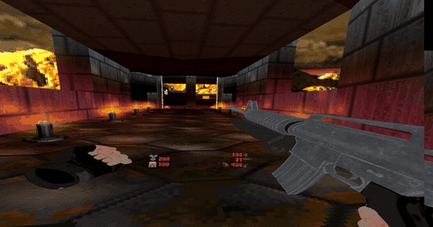
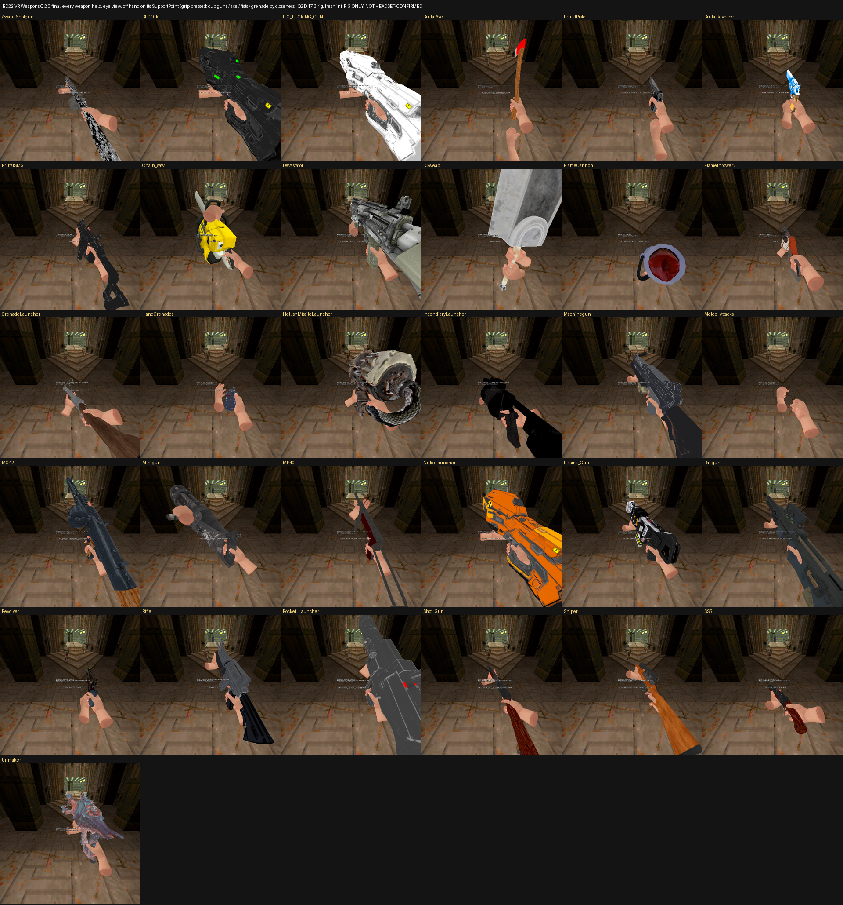
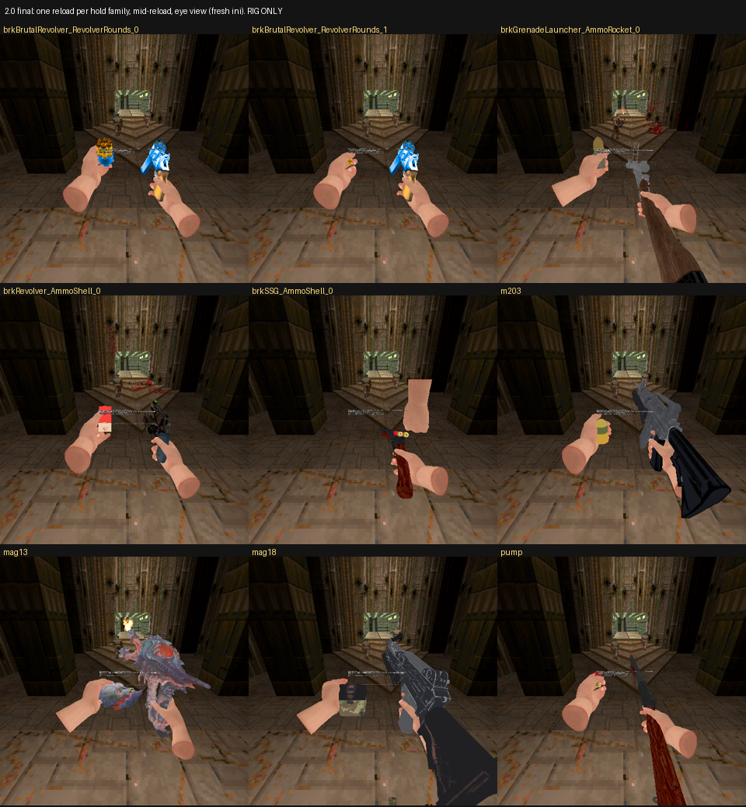
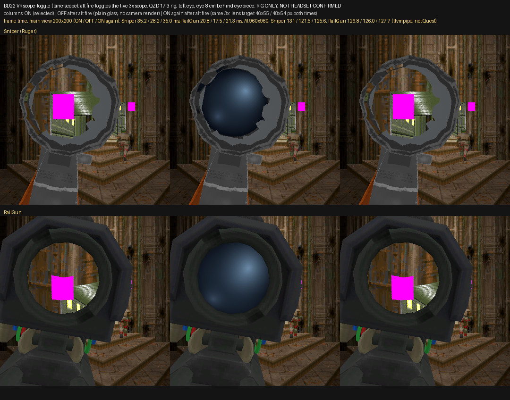
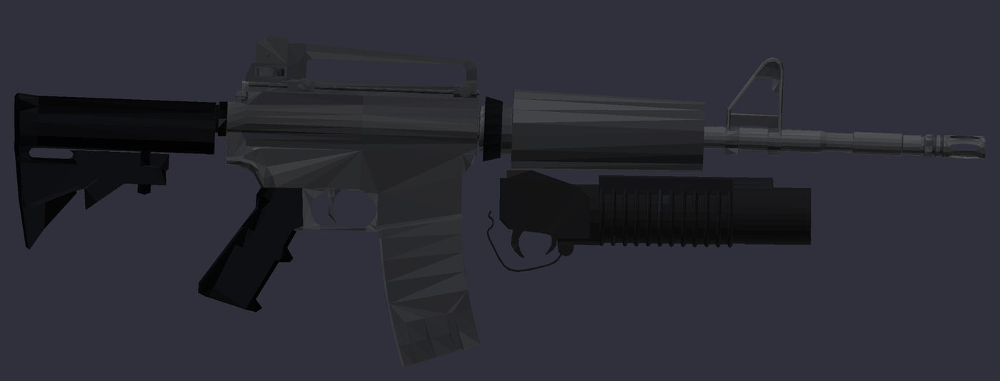
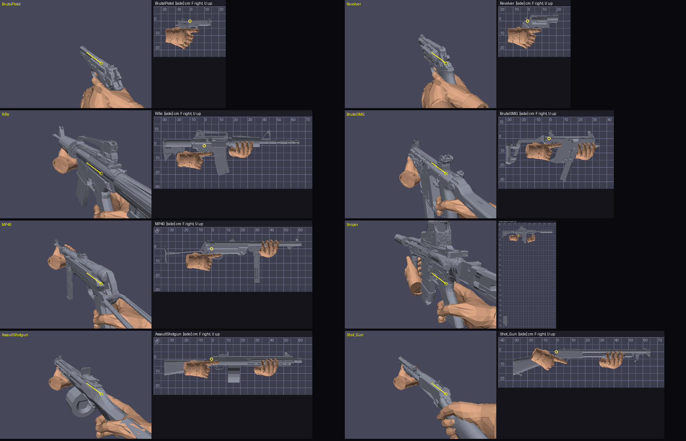
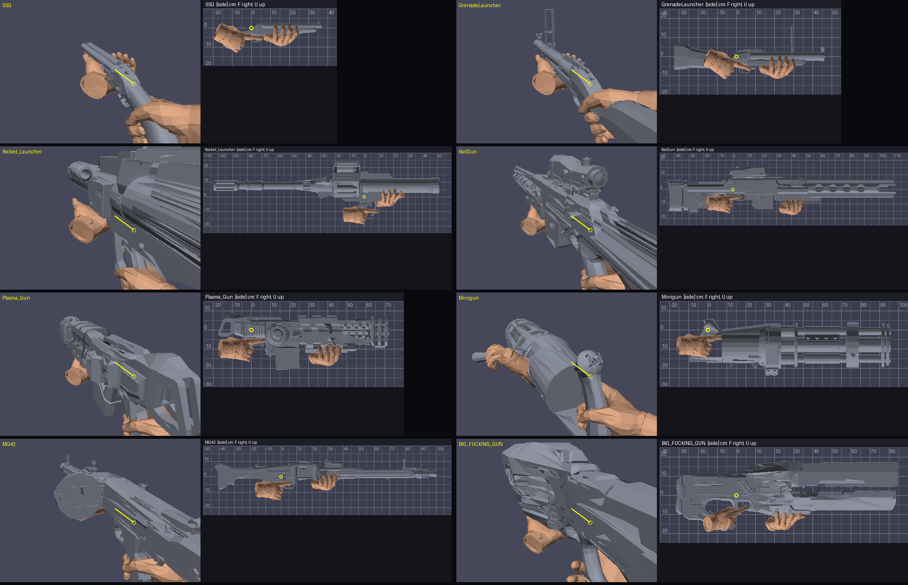
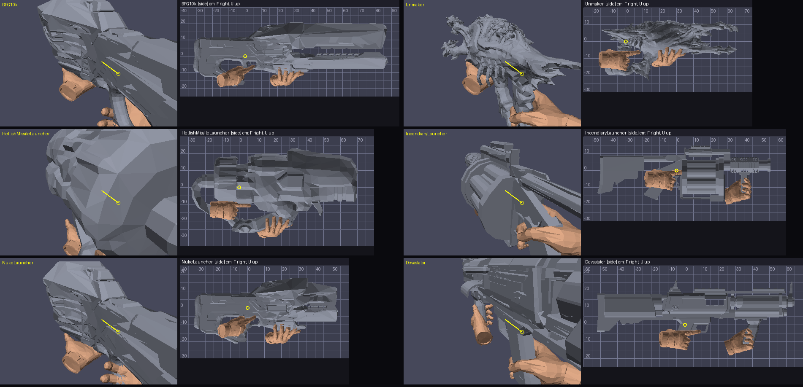

# BD22 VR Weapons 2.0

**Brutal Doom v22 in VR. Your hands. Every gun.**

Grab the rifle by its handguard and the trigger is under your finger. Rip the magazine out, reach
to your belt, slam a fresh one home, and rack it. Break the Super Shotgun, thumb in two shells, flick
it shut. Hold the Ruger to your eye and the scope is a real 3x window, not a sticker. Pull the pin
with your other hand and throw. Choke up on the chainsaw by its top handle. Swing the Dragonslayer
two-handed. Every gun in Brutal Doom, held, aimed, fired and reloaded with your own two hands.

Project conceptualized, directed and coordinated by **PresidentKoopa**. All coding done by
agentic **Claude**.

A VR weapon pack for **Brutal Doom v22** (`brutal22test6.pk3`) on **QuestZDoom 17.3**, built for
**standalone Quest**. It runs on the stock engine with no engine changes. It's an add-on: Brutal
Doom stays Brutal Doom. It replaces none of its guns, every gun fires at Brutal Doom's own rate
and does its own damage, and with the options off it plays exactly as Brutal Doom shipped.



## Install

Download the pk3 from the Releases page and load, in this order:

```
doom2.wad  ->  brutal22test6.pk3  ->  BD_VoxelPack.pk3  ->  BD22_VR-Reloaded_2.0.pk3
```

Use Doom 2, not Freedoom: the voxel pack names Doom 2's own sprites.

To build it yourself: `python build.py` zips `src/` into `BD22_VR-Reloaded_<VERSION>.pk3`.

## What's new in 2.0
Everything here was checked on the test rig on the load order above, with no script errors from
the pack. It has not yet been confirmed in a headset.

### Hands on every gun
- **New hands on every weapon**, both hands: the hand that holds the gun, with the finger on the
  trigger, and a support hand that wraps the gun's forend, pump, handguard or foregrip. The gun is
  moved to fit your hand, and everything on it (muzzle, ejection port, reload points, scope) moves
  with it. Each grip started from the 1.92 hold on that gun.
- **Melee:** chainsaw (index on the real trigger, other hand on the top handle), sword (two hands
  on the hilt), axe (on the haft). Their hit points moved with them.
- **The FlameCannon** is worn: your hand goes in through the slit at the back, and the flame now
  starts at the nozzle (it used to start 27 cm away). Open palm under the barrel.
- **Fists, the free off hand, the grenade hand and all 25 reload holds** (every magazine, shell,
  rocket, the Unmaker skull, the Moonlight round) use the same hands.
- **Hand Skin Tone:** 18 steps, from porcelain to ebony, plus grey, green, blue, purple, red, gold
  and a black glove.

### Scopes
- **Ruger and Railgun: a live 3x view through the lens**, on by default. Alt fire turns the scope
  on and off, to save performance. On the Ruger this replaces Brutal Doom's zoom.

### Shooting
- **True Bullets: On / Off** (default On). On fires real rounds from the muzzle at 80 units a tic,
  with the same damage as Brutal Doom's hitscan, drawn with Dakka's bright tracers and impact sparks.
  Off is stock Brutal Doom: hitscan, its own tracers and puffs (and the Ruger's rail trail), no
  Dakka effects. (This one switch replaces "Player Ballistics" and "Shot Tracers".)
- **Pump Shotgun Spread: Stock / Enhanced:** Enhanced spreads up and down too. Same pellets and
  damage.
- **Ruger** (True Bullets On) fires a sniper round that pierces like Brutal Doom's rail, with the
  same damage. The beam is gone.
- **Dual wield:** off-hand shots now leave the off-hand gun's muzzle.

### Revolvers and ammo
- Two revolvers: the **Shotvolver** (its slug alt fire is now on by default) and the **Moonlight**.
  The Moonlight takes the Brutal Pistol's ammo (2.0.1): each shot costs 3 pistol rounds, so a full
  six-shot cylinder is 18. A reload moves 3 pistol rounds per chamber from your pistol reserve; two
  Moonlights share that reserve. Its HUD reads shots in the cylinder (0-6) | pistol rounds in reserve.
- Options: **Moonlight Replaces Pistol** (start, pickups, drops) and **Start With Two Moonlights**.
  Both are off by default.
- **HUD Ammo:** the magazine and the reserve (e.g. 24 | 120), or Reserve Only.
- **Ammo on top:** a loaded magazine never counts against what you can carry.
- **The Minigun has its own ammo:** 400 in reserve (800 with a backpack), plus its 200-round
  magazine.

### Fixes
- Giant shell casings when firing shotguns. Fixed.
- The dual Shotvolver stopped the main gun firing after one off-hand shot. Fixed.
- The Shotvolver's slug alt fire also fired a free pellet blast. Fixed.
- The Purist Sniper showed an empty hand. Fixed. The Purist Rifle shows its grenade tube, and its
  alt fire does nothing.
- Butt-strike and pistol-whip hits now land at the gun you see.
- The grenade was drawn 1.45 cm off. Fixed, and the throw now leaves from the grenade in your hand.

### Options and melee (2.0.2, rig only, not headset-confirmed)
- **Pistol Whip** (on by default): swing a pistol or revolver into something. It has its own
  option row. The kick-key "Gun Bash" is gone; the kick key is Brutal Doom's boot again.
- **Melee hit flash** is a small spark where the blow lands (about 38 cm across; it was 2.3 to
  2.8 m).
- **Two axes, never two hands.** The axe no longer goes two-handed. Get the axe and a second one
  comes with it; press the Dual key to hold one in each hand. Each axe swings, cuts and throws from
  its own hand (VR throwing: hold that hand's trigger, swing, let go). A thrown off-hand axe comes
  back when you pick an axe up. Dual Options > Axe turns it off.
- **Sword:** a blow needs a deliberate swing: the blade's point must travel about a metre at
  speed, and after a swing there is a third of a second before the next one, so one swing is one
  attack. On the rig: hand jitter, sliding and wrist turns gave 0 attacks; one swing gave exactly 1.
- **Pull a Loaded Gun's Bolt (look only)** (was "Check the Chamber by Hand", off by default): with
  no reload running, your off hand can pull back the charging handle or slide of a loaded gun and
  let it go, to look. Nothing is loaded, ejected or chambered.
- **Two-Hand Grip (engine)** (was "Two-Handed Steadying"): QuestZDoom's own two-hand setting,
  unchanged. On: grip with your off hand near the gun to steady it with both hands.

## What was new in 1.99

### Every gun reloads by hand
Every gun that isn't a melee weapon reloads with your hands: **23 guns**. The BFG and BFG10k stay
as Brutal Doom made them.

| How it reloads | Guns |
|---|---|
| Magazine | Rifle, Pistol, SMG, MP40, Assault Shotgun, Railgun, Plasma Gun, Ruger, Rocket Launcher, Machinegun (100-round box) |
| Drum, canister or box | MG42 belt drum, Flamethrower canister, Unmaker skull, Minigun ammo box, Hellish launcher's rear drum |
| Cylinder | Incendiary Launcher (six shots) |
| Bay or block | Devastator loading bay, Nuker warhead block |
| Pump | Shotgun |
| Break-open | Super Shotgun, Grenade Launcher, Shotvolver, Revolver (Moonlight), and the 40 mm under the Rifle and the Machinegun |

Pull the part out with your off hand, reach to your belt for a fresh one, and push it home.

Brutal Doom never reloads most of the heavy guns at all. On those, the part you swap was cut out
of the gun's own model, and it counts down Brutal Doom's own ammo. The ammo you carry and the
damage you do are still exactly Brutal Doom's.

### Throwing the axe
- Hold the throw and a **lock-on ring** goes on the monster your hand points at. It's the same
  mark as the ShieldSaw and the QuestSaber.
- If you let go without throwing, the ring **stays on for a second**. Pick the hold back up and
  you're still locked.
- The throw **blends your arm's swing with where your hand points**, as the ShieldSaw does.

### New guns from Brutal Doom 21
- **BD21 Machinegun** (M249 with an underbarrel 40 mm). Off by default:
  "Machinegun replaces MG42".

### Melee
- **Gun bash** (removed in 2.0.2): your kick key bashed with the gun you were holding.
- **Pistol whip**: swing a pistol or revolver into something.
- **Butt strike**: drive the stock forward with both hands. Works on all eight guns with a stock.
  Off by default.
- **Real punching** with either fist. Punching a switch or a door works it. Off by default.

### Every gun shoots like itself
These are behind the **Ballistics** switch. Stock is Brutal Doom's own.
- **Recoil** for 22 guns, each worked out from its own cartridge and weight. In VR it moves the
  gun in your hands, never your view.
- **Muzzle flash** light for 18 guns, and an echo for 14 that sounds different indoors and
  outdoors.
- **Visible rounds in flight** for 11 guns, at their real speed.
- **Impact sounds** per surface, **ricochets** off shallow angles, and **brass** from each gun's
  real ejection port, as 3D casings.

### Fixes
- **Guns no longer spin round your shoulder.** Recoil kept adding to itself during reloads and
  turned the gun. It now kicks and settles.
- **No muzzle flash or gunshot echo without a shot.** Footsteps, kicks and the reload buzz were being
  taken for gunshots.
- **Brutal Doom's own ricochet, glass, sparks and magazine-drop sounds are back.** Some of the
  pack's sound files had the same short names and were playing in their place.
- **Fire rates:** QuestZDoom 17.3 lets a held trigger re-fire some guns faster than Brutal Doom
  does on PC: the pistol, the pump shotgun, the Incendiary Launcher and the dual pistols. They're
  held to PC's rate now. The Ruger is one shot per pull.
- **Rounds you pull out stay yours:** pull a part-full magazine with no reserve left, and its
  rounds go back in when you seat it again.
- **Incendiary Launcher:** pressing reload did nothing. Fixed.
- **Flamethrower:** it returned to the wrong frame after firing. Fixed.
- **Dot scope:** it could stop the game's scripts running, on the Railgun and the Ruger. Fixed.
- **Ruger:** it drew 2D sprites while firing. Fixed.
- **Purist Rifle:** it fired the M203. Fixed.
- **Grip-mode charging handle:** a racked handle could not be grabbed. Fixed.
- **Axe alt-fire hold:** it did nothing for players upgrading from older builds. Fixed.
- The pk3 is about **30 MB**: models are LZMA-compressed, as 1.96b's were.

### Fixes from the owner's 1.99 headset pass
- **Recoil is gone.** It turned the gun model, so the gun spun around the shoulder and pulled
  away from the hands. Hold poses at rest match 1.92 again.
- **The Nuker uses the BFG's hands.** It is the same model, so it gets the same grip and trigger
  finger, fitted to its size.
- **Chainsaw** grip hand moved 2 cm left. **Incendiary Launcher** grip hand moved 2 cm forward.
- **Real magazines** on the Flamethrower (100), Machinegun (100), Unmaker (200) and Minigun (200):
  every shot comes out of the magazine, the reserve is what is left in your pouch, and a reload
  moves rounds from the pouch into the gun.
- **Machinegun:** the 40 mm round, its latch and the hands sat 5 cm high. Fixed.
- **MG42, Flamethrower, Unmaker:** the gun no longer jumps 5 cm when a reload starts.
- **Axe and sword** cut only on a down or side swing, never an upswing, and need a harder swing.
  Turn off "Two-Hand Grip (engine)" (then called "Two-Handed Steadying") to hold them with one controller: grip with your off hand near
  the blade and you get the two-handed pose. Guns lose steadying too while it is off.
- **Spent casings with the voxel pack** are normal size again (a shell was drawn at four times
  Brutal Doom's size).

## Everything else
- Posed VR hands on every weapon: hand on the grip, finger on the trigger, support hand.
- Slides, charging handles, bolts and pumps racked by hand. Pistol slides and rifle, SMG and
  assault shotgun bolts lock back when fired dry.
- Shotgun shells go in through the real loading port, and you can top off any time.
- Kitbash M4 + M203. In VR: unlatch the tube, slide it forward, push a round in, slide it shut.
- SMG alt fire toggles 3-round burst or full auto. Slug shots for the shotgun and the Shotvolver
  are menu options, off by default.
- Pistol Semi Auto option: one shot per trigger pull.
- Dual wield, with each gun fired independently. Flick a gun down to reload when you're using two.
- Grenades: pull the pin with your off hand, swing and release to throw, or release while still
  to cook it.
- Left-handed support. Purist mode gives you models and hands, without reloading.

## Options
**Options → BD22 VR Weapons.** Here you'll find reloading (VR or Brutal Doom's stock reload), what
grabs the ammo, where a new magazine comes from, checking the chamber by hand, the scopes,
ballistics, real casings, throwing, punching, gun bash and butt strike, the dual-wield
and voxel pages, and a tuning and debug page for reloading.

Every option defaults to how Brutal Doom behaves, or to the gentler setting, except the VR hands
and reloading themselves. Set Reloading to "Stock (BD22)" and every gun reloads the way it always
did.

## Known gaps
- Still open from the 1.99 headset pass: a bang when a map loads and the BFG's sounds.
- The off-hand dual Railgun has no live scope of its own yet: its alt fire is still Brutal Doom's
  zoom.
- On the Nuker, both BFGs and the Hellish launcher, the support hand cradles the body rather than
  wrapping it: their models have nothing narrower to hold.
- The Minigun's ammo box in your hand is the small box off the gun. A bigger one is planned.
- The Minigun throws its brass from the body: its model has no ejection port.
- QuestZDoom 17.3 can't do recoil roll or the backward shove. Those need engine support this pack
  doesn't have.

## Versions
Public releases are numbered 1.9x and are the only tags on this repo. `main` is always the latest
public release plus any fixes on their way to the next one. Work in progress lives on the `dev`
branch under internal 2.x numbers.

This build is generated by the RSQ Weapon Depot. Every number in it is measured off a model or
parsed out of Brutal Doom's own code, and `src/README.txt` (shipped inside the pk3) has the long
version.

## Credits
**BD22 VR Weapons Q**: project conceptualized, directed and coordinated by **PresidentKoopa** (Radiant Silvergun). All coding done by agentic **Claude** (Anthropic), working under his direction.

Weapon models: **br_vr** by ajantaju (Brutal Doom VR Weapons, BD v21), made from:
- Grenade by Gomuz; MP40 by Krystian; Shotgun by serg-654; Beretta M9 by damkung13
- Axe by martn00; M4A1 by seandxyz; Minigun by overlordchaos; DBS-2 by ironcladmax501
- SemiAuto Shotgun by Derak Derantick; Grenade Launcher 2 by watercat; RPS-6 by David Short
- KRISS Vector by Bandit; Chainsaw by 3DHaupt; M16A3/M203 by rubenve; M249 by Buce
- M79 by omgitstallin; Rorsch Mk-1 by CrazyRusEnginer; M13-Gaus (plasma) by DigitalTales
- RD-100 (BFGs) by Cameron Chung Art; Flamethrower (TF2) by arminalcapon
- Mancubus flame cannon by Arthur Manhaes; Dragonslayer by Jakob Pihl; MG42 by TastyTony
- Taurus Judge by Tori-nyan; Boot by Nicolas.KoiSculpt; Fingerless Glove by 3DMaesen
- Revenant missile launcher and Reaper by id Software (Doom 2016)

(All from Sketchfab; textures edited.)

- VR hands: Ermac (Force Unleashed / Rusted Legacy, MIT). The 2.0 hands were fitted starting
  from his 1.92 holds.
- Brutal Doom: Sergeant Mark IV
- QuestZDoom: Team Beef
- Shot tracers, impact sparks and their sprites (DPUF, shipped as RSDP): **Dakka** by ijon
  (https://github.com/0dot0repeating/dakka, WTFPL), ported to ZScript
- Player Ballistics (Bullet mode): ported from PresidentKoopa's RS_Ballistics `enemyfire.zs`

## Screenshots









